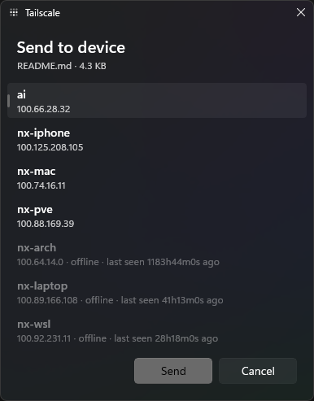
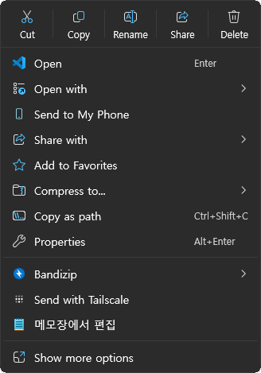

# TailShare

<table align="center">
  <tr>
    <td width="33%" align="center">
      <br /><sub
        >TailShare Menu</sub
      >
    </td>
    <td width="33%" align="center">
      <br /><sub
        >Tailscale on Windows Sharing</sub
      >
    </td>
    <td width="33%" align="center">
      <br /><sub
        >"Send with Tailscale" on Context Menu</sub
      >
    </td>
  </tr>
</table>

Adds a **Tailscale** target to the Windows 11 share sheet. Picking it lists your Taildrop
devices (`tailscale file cp --targets`) and sends the shared files with
`tailscale file cp <files...> <peer>:`. Results show as toasts. Folders are rejected
(Taildrop sends files only).

It also adds **Send with Tailscale** to the Windows 11 top-level File Explorer context menu
(shown when the selection contains at least one file). That's an `IExplorerCommand` served
out-of-proc by `TailShare.exe -Embedding` (`com:ExeServer`), which launches
`TailShare.exe <paths...>` on click, or `--paths-file <list>` for long selections.

WinUI 3 (.NET 10, self-contained incl. Windows App SDK WinUI) + a sparse package (packaging with
external location) for identity; the exe lives in the install dir (default `C:\Tools\TailShare`).

## Requirements

- Windows 11
- Tailscale for Windows at `C:\Program Files\Tailscale\tailscale.exe`
- .NET 10 SDK (to build)

## Setup

1. Configure your package identity. Copy `config.example.psd1` to `config.local.psd1`
   (gitignored) and set `IdentityName`, `Publisher`, `PublisherDisplayName` and optionally
   `InstallDir`. Without it, generic defaults (`TailShare`, `CN=TailShare`) are used.

2. Build and register:

   ```powershell
   # once, from an elevated prompt of the same Windows account: self-signed cert with
   # Subject = Publisher, trusted in LocalMachine\TrustedPeople
   .\scripts\cert.ps1

   .\scripts\build.ps1      # publish -> InstallDir, makepri, makeappx /nv, signtool -> out\TailShare.msix
   .\scripts\register.ps1   # Add-AppxPackage -ExternalLocation <InstallDir>
   ```

Remove: `.\scripts\unregister.ps1 [-RemoveFiles]`

Code-only changes need just `build.ps1` (it re-mirrors the exe); re-run `register.ps1` when
`package/` or the config changes. After changing `Publisher`, run `cert.ps1` again.

### Where the identity goes

`build.ps1` reads the config (`scripts\Config.ps1`) and fills it into
`package\AppxManifest.template.xml` (the sparse package manifest) and, through the
`TailSharePackageName` / `TailSharePublisher` MSBuild properties, into the exe's `<msix>` element
generated from `src\TailShare\app.manifest.template`. Both must match, and `Publisher` must equal
the signing certificate's subject.

## Icons

Icons follow the light/dark theme. Source art is in `art/` (`icon.png` plated tile,
`icon-light.png` / `icon-dark.png` glyphs for light / dark theme); `scripts\make-icons.ps1`
regenerates `package/Assets` (targetsize + `altform-unplated` / `altform-lightunplated` logos,
`TailShare-light.ico` / `TailShare-dark.ico`), and `build.ps1` indexes them into a
`resources.pri` with makepri, placed both in the package and next to the exe — the shell resolves
the logos of a package with external location against the install dir, so without the copy there
it only finds the plain `Square44x44Logo.png`. (The app's own XAML uses `TailShare.pri`.) Title
bar and context-menu icons pick an `.ico` from the app theme at runtime.

## Debugging

- Log: `%TEMP%\TailShare\TailShare.log` (activation kind, file counts, errors, toasts).
- `<InstallDir>\TailShare.exe <file|folder>...` runs the same picker/send flow without the
  share sheet (still with package identity, so toasts work).

## Layout

| Path                                  |                                                                                           |
| ------------------------------------- | ----------------------------------------------------------------------------------------- |
| `config.example.psd1`                 | template for `config.local.psd1` (package identity, install dir)                          |
| `package/AppxManifest.template.xml`   | sparse package manifest (share target, context menu, COM server)                          |
| `src/TailShare/app.manifest.template` | `<msix>` element binding the exe to the package identity                                  |
| `src/TailShare/Program.cs`            | reads `AppInstance.GetActivatedEventArgs()` before XAML starts                            |
| `src/TailShare/ExplorerCommand.cs`    | context-menu `IExplorerCommand` + COM class factory (`-Embedding`, idles out after 2 min) |
| `src/TailShare/ShareFlow.cs`          | items → paths → `ReportDataRetrieved` → pick → send → toast → `ReportCompleted`           |
| `src/TailShare/Tailscale.cs`          | CLI wrapper and `--targets` parser                                                        |
| `src/TailShare/PeerPickerWindow.xaml` | device picker / sending progress                                                          |

## AI usage disclosure

This project was built with AI assistance. The code, scripts and documentation were written with
Claude Opus 5.5 (Anthropic) in Claude Code, directed and tested by the author.

## Trademarks

Tailscale is a trademark of Tailscale, Inc.
TailShare is not affiliated with Tailscale Inc.

## License

[MIT](LICENSE)
